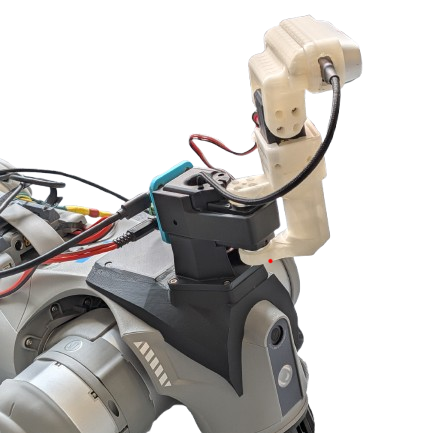

# Pan-Tilt camera arm for Unitree Go2

This arm partly uses SO-101 parts, servos and control boards, the project can be found here : [https://github.com/TheRobotStudio/SO-ARM100/tree/main](https://github.com/TheRobotStudio/SO-ARM100/tree/main)

The version provided here is meant for a Realsense D435i but any camera can be attached to it provided the camera mount is adapted ([CameraMount_realsense.stl](/3D-models/STL/CameraMount_realsense.stl))

## Bill of Materials:

| Name      | Quantity      |
| ------------- | ------------- |
| STS3215 (any gear ratio will do) | 2 |
| Waveshare Serial Bus Servo Driver Board | 1 |

And a bunch of M3 screws of various sizes.

## Build guide
### Printing
A ready-to-print on the PrusaXL 3MF profile with all parts is available in [/print-files/prl_go2_pan_tilt_cam_prusaXL.3mf](/print-files/prl_go2_pan_tilt_cam_prusaXL.3mf).  
The meshes for the pieces can be found in [/3D-models/STL](/3D-models/STL). If printing this way, copy the piece orientation found in the 3mf file.    

Add M3 inserts to the larger holes of [CameraMount_realsense.stl](/3D-models/STL/CameraMount_realsense.stl).  

### Assembly
A reference of which part goes where is available on [/3D-models/FCStd/Assembly.FCStd](/3D-models/FCStd/Assembly.FCStd)  

The order of assembly is the following:
  
1. Attach the helmet on the front of the Go2  
2. Slide one of the servos in [Base.stl](/3D-models/STL/Base.stl)  
3. Secure it by sliding [Base_motor_holder_SO101.stl](/3D-models/STL/Base_motor_holder_SO101.stl) over the base + servo assembly  
4. Screw [Rotation_Pitch_SO101.stl](/3D-models/STL/Rotation_Pitch_SO101.stl) to the servo   
5. Slide the second servo in the other end of [Rotation_Pitch_SO101.stl](/3D-models/STL/Rotation_Pitch_SO101.stl)   
6. Slide [Motor_holder_SO101_Base.stl](/3D-models/STL/Motor_holder_SO101_Base.stl) over the servo and the part  
7. Attach [Arm2CameraMount.stl](/3D-models/STL/Arm2CameraMount.stl) to the moving part of the servo  
8. Screw your realsense D431i to [CameraMount_realsense.stl](/3D-models/STL/CameraMount_realsense.stl)  
9. Screw the camer& + [CameraMount_realsense.stl](/3D-models/STL/CameraMount_realsense.stl) assembly to [Arm2CameraMount.stl](/3D-models/STL/Arm2CameraMount.stl)  

## Adapting the design
We provide CAD Freecad files in [3D-models/FCStd](/3D-models/FCStd/) that are easier to modify than STLs. 